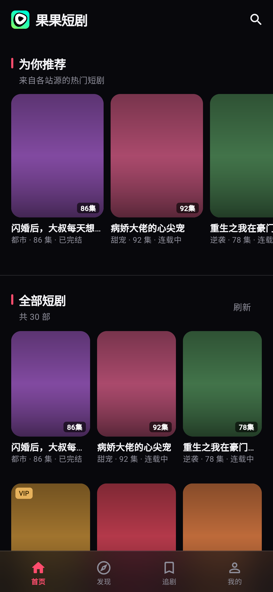
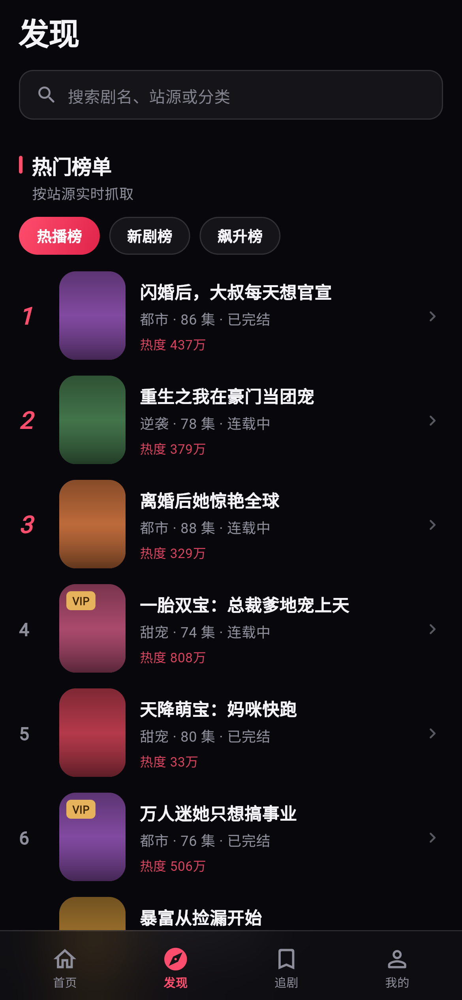
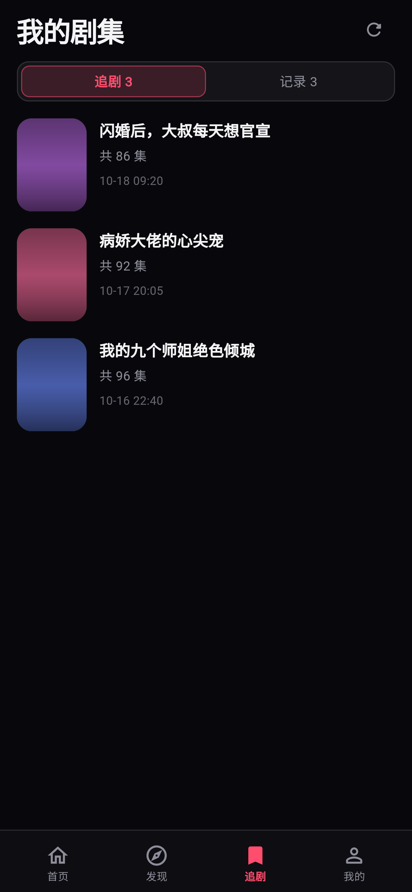
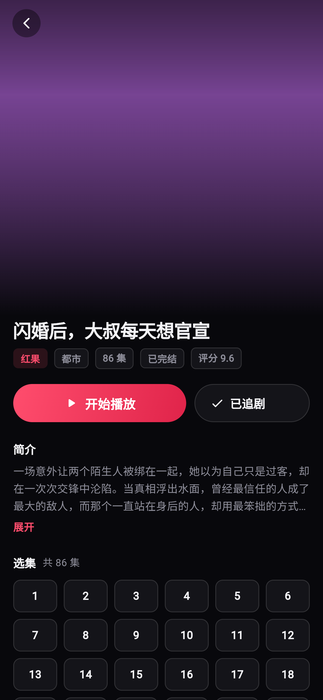
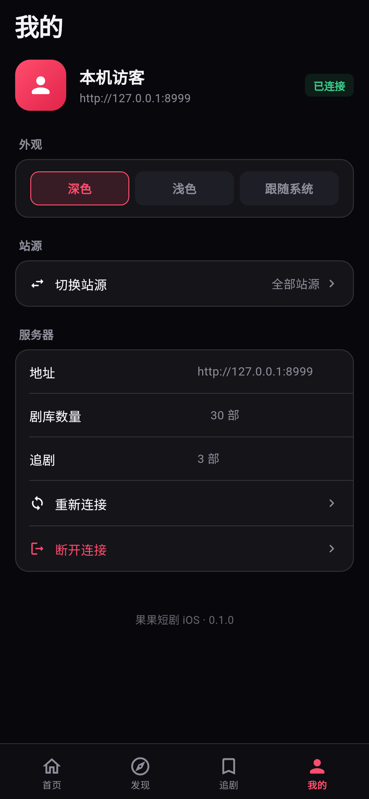
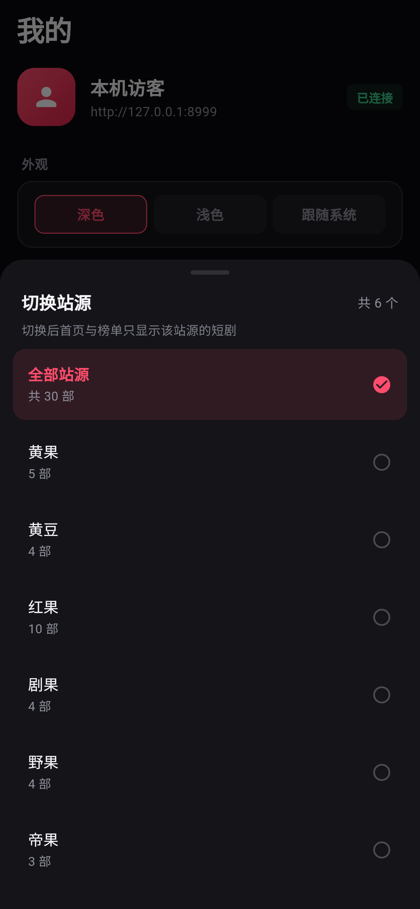

# 短剧库 iOS 客户端

参照「秋秋短剧」的技术路线与交互做的 iOS 客户端：**Flutter（Dart 3）**，
通过 HTTP 直连运行在电脑 / NAS 上的短剧库服务。App 只负责「浏览 + 播放 + 追剧」，
下载、合并、Emby 导出仍由服务端完成。

本目录是仓库里的 `app/` 子目录，服务端（Go）在仓库根目录，两者同一个仓库、同一份版本历史。
App 与服务端唯一的耦合是下面「用到的服务端接口」那张表 —— 服务端改了字段，这里要跟着改，
因此接口变更应该在**一次提交**里同时改完两边。

## 界面预览

| 首页 | 发现 / 榜单 | 我的剧集 | 详情 | 我的 |
| --- | --- | --- | --- | --- |
|  |  |  |  |  |

换源面板（「我的 → 站源 → 切换站源」）：



> 截图来自 `flutter build web` + 本地模拟服务端，视口 390×844 @3x。

## 换源

站源切换放在「我的 → 站源 → 切换站源」，不在浏览页露出入口，和参考 App 一致：

- 选项为「全部站源」+ 剧库里出现过的每个站源（附该站源的剧目数量）
- 选择后写入本地偏好，重启 App 保留
- 首页「为你推荐 / 全部短剧」只显示该站源的剧
- 发现页「热门榜单」只保留该站源提供的榜单，并提示当前站源

## 参考 App 的技术分析

对 `zhenguojian-0.2.71+77-ios-unsigned.ipa`（显示名「秋秋短剧」）解包得到的结论：

| 项 | 结论 |
| --- | --- |
| 框架 | Flutter（`Flutter.framework` + `App.framework`，Dart AOT 快照） |
| 播放内核 | `media_kit` + `libmpv` + `ffmpeg_kit_flutter_new_min_gpl`，另带 `video_player_avfoundation` / `chewie` |
| 画质增强 | Anime4K / FSRCNNX / RAVU 的 glsl + hook，走 mpv 着色器 |
| 状态管理 | `provider` |
| 局域网发现 | `nsd_ios`（Bonjour，服务类型 `_zgj-link._tcp`） |
| 本地存储 | `shared_preferences`、`path_provider`、`safe_local_storage` |
| 系统能力 | `file_picker`、`package_info_plus`、`wakelock_plus`、`flutter_foreground_task`、`screen_retriever`、`window_manager` |
| UI 风格 | `liquid_glass_widgets`（iOS 26 液态玻璃） |
| 构建环境 | Xcode 26.6 / iOS SDK 26.5 / 最低 iOS 15.1 / 仅 arm64 |
| 业务特征 | 多站源（剧果、帝果、红果、野果、黄果、黄豆…）、弹幕、追剧、下载合并、Emby 导出、设备配对推送 |

本客户端沿用同一条技术路线（Flutter），但播放器先用系统 `video_player`（AVPlayer 直接吃 HLS），
后续要支持更多封装格式再换 `media_kit`。

## 目录

```
app/                          ← 本目录，Flutter 工程根
  lib/
    core/     api.dart（接口客户端） theme.dart（设计令牌） prefs.dart（本地偏好）
    models/   drama.dart（剧集 / 播放会话 / 取流结果）
    state/    app_state.dart（全局状态，Provider）
    screens/  连接 / 首页 / 发现 / 搜索 / 追剧 / 详情 / 播放器 / 我的
    widgets/  封面卡、毛玻璃容器、空状态等
  ios/        Xcode 工程（Runner，bundle id com.juku.juku，最低 iOS 15.0）
  web/        仅供本地预览界面用
  tool/       mock_server.py（本地假数据服务端，做界面联调用）
  preview/    界面截图
.github/workflows/ios.yml     ← 仓库根，macOS 云构建，产出未签名 IPA
```

## 用到的服务端接口

| 功能 | 接口 |
| --- | --- |
| 剧库列表 | `GET /api/ui/dramas?revision=` |
| 推荐 | `GET /api/ui/recommendations` |
| 榜单 | `GET /api/ui/rankings`、`GET /api/ui/rankings?board=&page=` |
| 分类 | `GET /api/ui/categories?source=` |
| 搜索 | `GET /api/ui/search?q=` |
| 追剧 | `GET/POST /api/ui/following` |
| 观看记录 | `GET /api/ui/playback/history` |
| 打开播放 | `POST /api/ui/playback/open` |
| 取流地址 | `POST /api/ui/playback/hls/open` → HLS，交给 AVPlayer |
| 进度上报 | `POST /api/ui/playback/progress` |

服务端播放接口会校验 `Sec-Fetch-Site` / `Origin`，原生客户端不带这两个头即可通过；
但要求 `Content-Type: application/json`，且请求体字段必须与服务端结构体完全一致。

## 本地开发

在 `app/` 目录执行：

```bash
flutter pub get
flutter run                    # 真机 / 模拟器
python tool/mock_server.py     # 另开一个终端，起本地假数据（127.0.0.1:8999）
flutter build web              # 浏览器里预览界面
```

## 出包（未签名 IPA）

iOS 编译必须用 macOS。仓库根目录自带 GitHub Actions 工作流（`.github/workflows/ios.yml`，
`working-directory` 已指向 `app/`），推送到 `main` 或在 Actions 页面手动触发 `Build iOS IPA`，
运行结束后在 Artifacts 里下载 `juku-ios-ipa`，里面就是 `juku-unsigned.ipa`。

工作流按 `paths` 过滤，只有改动 `app/**` 才会触发，改服务端代码不会白烧 macOS 构建分钟。

本地有 Mac 时等价命令（在 `app/` 目录执行）：

```bash
flutter build ios --release --no-codesign
mkdir -p Payload && cp -R build/ios/iphoneos/Runner.app Payload/
zip -qry juku-unsigned.ipa Payload
```

未签名 IPA 可用 AltStore / Sideloadly / TrollStore 自签安装。

## 与服务端的关系

- 唯一的耦合是 HTTP 接口：契约见上面那张表，实现见 `lib/core/api.dart`
- 服务端改字段时，这里要同步改；App 端解析做了多字段名兜底（`cover`/`coverUrl`/`poster` 等），
  但字段整体改名会静默显示为空，排查时先看 `lib/models/drama.dart` 的 `fromJson`
- 版本号仍各自独立：App 在 `app/pubspec.yaml`（当前 `0.1.0+1`），服务端在 `internal/app` 的版本常量；
  但两者在同一个仓库、同一个 tag 下发布，一次 release 同时产出服务端二进制和 ipa
- 服务端默认监听 `0.0.0.0:8998`，App 连的是 `http://电脑IP:8998`

## 改名字与换图标

名称和图标都还是占位，正式定下来后按下表改（都是普通源码改动，一次提交即可，不影响已有历史）。

**App 名称**散落在 6 处，要一起改：

| 位置 | 当前值 | 影响 |
| --- | --- | --- |
| `ios/Runner/Info.plist` → `CFBundleDisplayName` | 短剧库 | **桌面图标下的名字**，最重要 |
| `lib/app.dart` → `MaterialApp.title` | 短剧库 | 系统任务切换里的标题 |
| `lib/screens/connect_screen.dart` | 短剧库 | 连接页大标题 |
| `lib/screens/home_screen.dart` | 短剧库 | 首页标题 |
| `lib/screens/profile_screen.dart` | 短剧库 iOS · 0.1.0 | 「我的」页版本行 |
| `web/index.html`、`web/manifest.json` | juku | 只影响 web 预览，不影响 ipa |

**图标**只需替换 `ios/Runner/Assets.xcassets/AppIcon.appiconset/` 下的 15 个 PNG，
尺寸必须与 `Contents.json` 声明一致（20/29/40/60/76/83.5/1024 各倍率）。
拿一张 1024×1024 的图，用 `sips` 或任意工具批量缩放覆盖即可。

两条硬要求：

- 1024×1024 那张**不能带 alpha 通道**，否则 App Store Connect 直接拒收。本项目图标已处理过；
  换图后若新图带透明，跑一次 `python tool/strip_icon_alpha.py` 即可
- 不要自己画圆角，iOS 会自动裁

**Bundle ID（`com.juku.juku`）才是不能随便改的那个**，见下节。

## Bundle ID

`PRODUCT_BUNDLE_IDENTIFIER = com.juku.juku`（在 `ios/Runner.xcodeproj/project.pbxproj`，共 6 处，
其中 3 处是 RunnerTests，改主 ID 时一并改）。

- 自签安装（AltStore / Sideloadly）时，bundle id 决定「装上去是覆盖升级还是并排两个 App」
- 一旦在 App Store Connect 注册过，**永久不可改**，只能新建一条 App 记录
- 所以正式上架前就该定好（通常是域名反写，如 `com.yourdomain.duanju`），现在改成本最低

## 待办

- [ ] 局域网自动发现（Bonjour `_juku-link._tcp`）与设备配对
- [ ] 弹幕渲染与开关
- [ ] 下载任务列表 / Emby 导出入口
- [ ] 分类筛选页（分类 chips 目前未在界面暴露）
- [ ] 播放器：清晰度切换、预加载下一集、画中画
- [ ] 登录与多用户（当前按匿名访问实现）
- [x] 换源（我的 → 站源）
